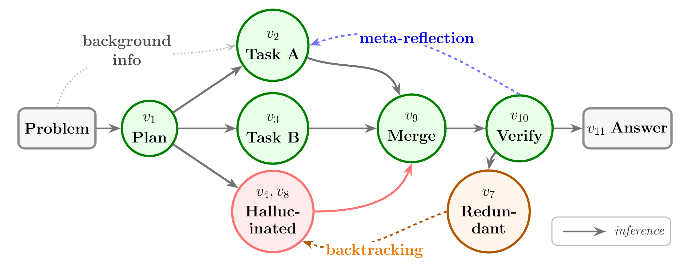
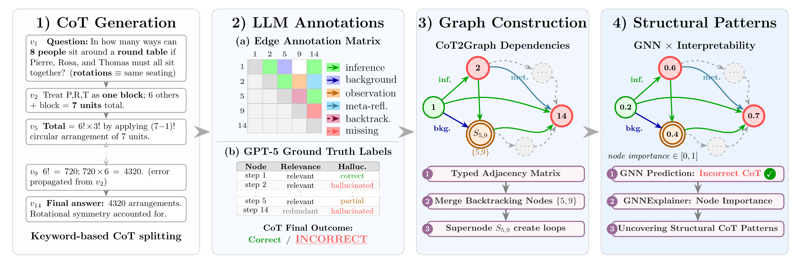

<div align="center">

<p>
  <picture>
    <source media="(prefers-color-scheme: dark)" srcset="assets/eth_dark.svg">
    
  </picture>
  &nbsp;&nbsp;&nbsp;&nbsp;
  <picture>
    <source media="(prefers-color-scheme: dark)" srcset="assets/lre_dark.png">
    
  </picture>
  &nbsp;&nbsp;&nbsp;&nbsp;
  <picture>
    <source media="(prefers-color-scheme: dark)" srcset="assets/emnlp_dark.png">
    
  </picture>
</p>

# Understanding Failures in LLM Reasoning<br>by Learning Structured Representations<br>of Chain-of-Thought

**EMNLP Conference 2026 (Findings)**

**Tommaso Felice Banfi**\*, **Mubashara Akhtar**\*, **Jingwei Ni**, **Mrinmaya Sachan**

**ETH Zürich** · Language, Reasoning and Education Lab (LRE)

<sub>\* Equal contribution</sub>

[](assets/paper-EMNLP2026.pdf)
[](assets/poster-EMNLP2026.pdf)
[](https://openreview.net/forum?id=wFTJZ8fvns)

</div>

<p align="center">
  
</p>

## Abstract

Chain-of-Thought (CoT) is central to improving reasoning in large language models, yet existing evaluation methods focus on step-level signals and ignore the underlying structure of reasoning traces. This raises a key question: what aspects of reasoning quality (i.e., correctness, efficiency, and failure patterns) are encoded in the structure of a CoT trace?
We introduce **CoT2Graph**, a framework that represents CoT traces as directed dependency graphs, making relationships between reasoning steps explicit and capturing patterns such as backtracking, branching, and subtask merging. We model these graphs with graph neural networks and use attribution-based explanations to identify structural patterns associated with reasoning quality.
CoT2Graph reveals distinct patterns of successful and failed reasoning: correct CoTs place greater importance on early planning, whereas incorrect CoTs are associated with overloaded synthesis steps and dependency violations. We further show that graph-based signals better predict whether a CoT leads to a correct answer, outperforming previous tree-based structural methods by up to 2.5% and simple length-based baselines by 7.8%, while also improving Best-of-N selection.
Overall, our results demonstrate that reasoning structure encodes rich signals about reasoning quality, motivating a shift from sequence-level evaluation to structural analysis.

<p align="center">
  
</p>

## Setup

```bash
conda create -n cot2graph python=3.10 -y && conda activate cot2graph
pip install -r requirements.txt && pip install -e .
export OPENAI_API_KEY=...        # LLM judge
huggingface-cli login            # GPQA and Llama-3.1 are gated
```

## Running the pipeline

All hyperparameters are in [`configs/default.yaml`](configs/default.yaml) and the prompts in [`prompts/`](prompts); both match the paper. Any key can be overridden on the command line; outputs go to `outputs/<dataset>/<model>/`.

```bash
# 1. Build CoT graphs
python -m cot2graph generate          # CoT traces (vLLM) + step segmentation
python -m cot2graph annotate-edges    # typed dependencies (Llama-3.1-8B-Instruct)
python -m cot2graph judge             # correctness, relevance, hallucination (GPT-5 Mini)
python -m cot2graph build-graphs      # merge repeated steps into the CoT graph

# 2. Analyses on GPQA
python -m cot2graph train-graph                           # correctness prediction + GNNExplainer
python -m cot2graph train-graph gnn.graph=tree_compressed gnn.explain=false   # LCoT2Tree baseline
python -m cot2graph train-node                            # step-level relevance / hallucination
python -m cot2graph explain                               # what separates correct from failed CoTs
python -m cot2graph efficiency                            # verification vs. path inefficiency
python -m cot2graph draw --id 32                          # render one CoT graph

# 3. Best-of-N on MMLU-Pro (N = 5)
for stage in generate annotate-edges judge build-graphs bestofn; do
  python -m cot2graph $stage dataset=MMLU-Pro generation.num_runs=5 "judge.tasks=[final_answer]"
done
```

Other generators: `model=DeepSeek-R1-Distill-Qwen-14B` or `model=MiMo-7B-RL`.

## Citation

```bibtex
@inproceedings{banfi2026understanding,
  title     = {Understanding Failures in {LLM} Reasoning by Learning Structured Representations of Chain-of-Thought},
  author    = {Tommaso Felice Banfi and Mubashara Akhtar and Jingwei Ni and Mrinmaya Sachan},
  booktitle = {The 2026 Conference on Empirical Methods in Natural Language Processing},
  year      = {2026},
  url       = {https://openreview.net/forum?id=wFTJZ8fvns}
}
```

## License

Code released under the [MIT License](LICENSE). Models and datasets keep their own licenses (e.g. Llama 3.1, GPQA).
